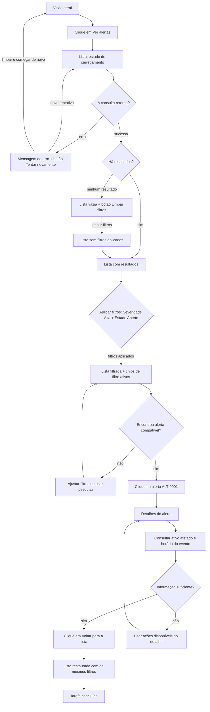

# Sprint 2 — Fluxo da tarefa prioritária

**Projeto:** SOC-unisul
**Etapa:** Sprint 2 — Estrutura (issue #4)
**Data:** 11/2026

## 1. Tarefa prioritária

> "Encontre um alerta de alta severidade que ainda esteja aberto e consulte qual ativo foi afetado e quando o evento ocorreu."

Essa é a tarefa definida na seção 10 da Sprint 1. Ela será usada na avaliação de 19/11 e no teste de usabilidade de 26/11. Todos os dados apresentados no fluxo são fictícios.

## 2. Diagrama do fluxo

## 3. Passo a passo com decisões

| # | Passo | Decisão da pessoa | Caminho alternativo | Retorno |
| --- | --- | --- | --- | --- |
| 1 | Abrir a visão geral | Ler os indicadores do período | Pular direto para a lista pelo botão "Ver alertas" | — |
| 2 | Abrir a lista de alertas | Esperar o carregamento | Se der erro, usar "Tentar novamente" | Erro com "Voltar para a visão geral" |
| 3 | Verificar os filtros ativos | Aplicar Severidade: Alta | Remover um filtro pelo chip "x" | Chips permanecem visíveis |
| 4 | Aplicar o estado | Marcar Estado: Aberto | Usar pesquisa por ID se souber o identificador | Contagem atualiza |
| 5 | Ler os resultados | Ordenar por horário mais recente | Se vazio, usar "Limpar filtros" | Volta para a lista completa |
| 6 | Escolher um alerta | Clicar no registro ALT-0001 | Se nenhum servir, ajustar filtros (passo 3) | Lista mantém contexto |
| 7 | Ler os detalhes | Anotar ativo afetado e horário | Ação simulada "Marcar em análise" com confirmação | — |
| 8 | Voltar à lista | Clicar em "Voltar para a lista" | Continuar navegando nos detalhes | Filtros preservados |

## 4. Confirmação do ativo e do horário

A pessoa confirma as duas informações na mesma tela de detalhes:

- **Ativo afetado:** linha própria com rótulo "Ativo afetado" e valor completo, por exemplo `srv-app-03 (Servidor de aplicações)`.
- **Horário do evento:** linha própria com rótulo "Horário do evento" e valor `12/11/2026 14:35`, com o fuso declarado no rodapé da página.

Os dois rótulos usam as mesmas palavras da tarefa ("ativo" e "horário"), para que a pessoa não precise traduzir termos da interface para os termos do enunciado. Essa decisão atende aos requisitos RC04 e RUA04.

## 5. Estados previstos no fluxo

| Estado | Gatilho | O que aparece | Ação de recuperação |
| --- | --- | --- | --- |
| Carregamento | Abertura da lista ou troca de filtros | Área da lista com blocos em esqueleto e texto "Carregando alertas…" | Nenhuma; a ação segue automaticamente |
| Erro de consulta | Falha simulada ao carregar | "Não foi possível carregar os alertas. Verifique a conexão e tente novamente." | Botão "Tentar novamente" |
| Lista vazia | Filtros sem correspondência | "Nenhum alerta encontrado com os filtros aplicados." | Botão "Limpar filtros" |
| Sucesso | Consulta com resultados | Contagem "12 alertas encontrados" e tabela preenchida | — |
| Confirmação | Ação simulada "Marcar em análise" | "Alerta ALT-0001 marcado como Em análise." com desfazer | "Desfazer" por 5 segundos |

Em todos os estados, os filtros aplicados e o cabeçalho permanecem na tela. A pessoa nunca perde a referência de onde está (RUA05, RF07).

## 6. Relação com os requisitos

| Requisito | Onde aparece no fluxo |
| --- | --- |
| RF02 — Lista de alertas fictícios | Passo 2 e tabela de resultados |
| RF03 — Abrir os detalhes | Passo 6 e 7 |
| RF04 — Filtrar por severidade | Passo 3 (Severidade: Alta) |
| RF05 — Filtrar por estado | Passo 4 (Estado: Aberto) |
| RF06 — Pesquisa por texto ou identificador | Caminho alternativo do passo 4 |
| RF07 — Estados de interface | Seção 5 |
| RF10 — Retorno preservando filtros | Passo 8 |
| RC01 — Dados fictícios | Rodapé da lista e do detalhe |
| RC02 e RC03 — Termos consistentes | Rótulos definidos no mapa de navegação |

## 7. Caminhos de erro e recuperação

1. **Erro ao carregar a lista:** a mensagem explica o que houve e oferece "Tentar novamente". A pessoa não precisa recarregar a página inteira nem voltar ao dashboard.
2. **Filtros sem resultados:** a mensagem cita os filtros aplicados e oferece "Limpar filtros", que devolve a lista completa com um clique.
3. **Pesquisa sem correspondência:** usa a mesma mensagem da lista vazia, com o termo pesquisado entre aspas.
4. **Ação simulada registrada:** a confirmação aparece com "Desfazer", para permitir correção imediata sem sair da tela.

Nenhum caminho de erro é beco sem saída: toda mensagem de erro e toda lista vazia trazem uma ação de recuperação visível.

## 8. Cobertura dos critérios da issue

- [x] Dashboard, acesso à lista, filtros de alta severidade e estado aberto, seleção e leitura do alerta representados.
- [x] Confirmação do ativo afetado e do horário, e retorno à lista preservando o contexto dos filtros.
- [x] Alteração e limpeza de filtros, ausência de resultados, carregamento e erro de consulta com recuperação.
- [x] Fluxo relacionado a RF02 a RF07 e RF10, com dados fictícios.
- [x] Diagrama salvo em `02-estrutura`.

## Referências

1. Sprint 1 — Estratégia & Escopo, seção 10 (fluxo prioritário). `01-estrategia-escopo/sprint-1-estrategia-escopo.md`
2. Mapa de navegação. `02-estrutura/mapa-navegacao.md`
3. Cenários e estados. `02-estrutura/cenarios-e-estados.md`
